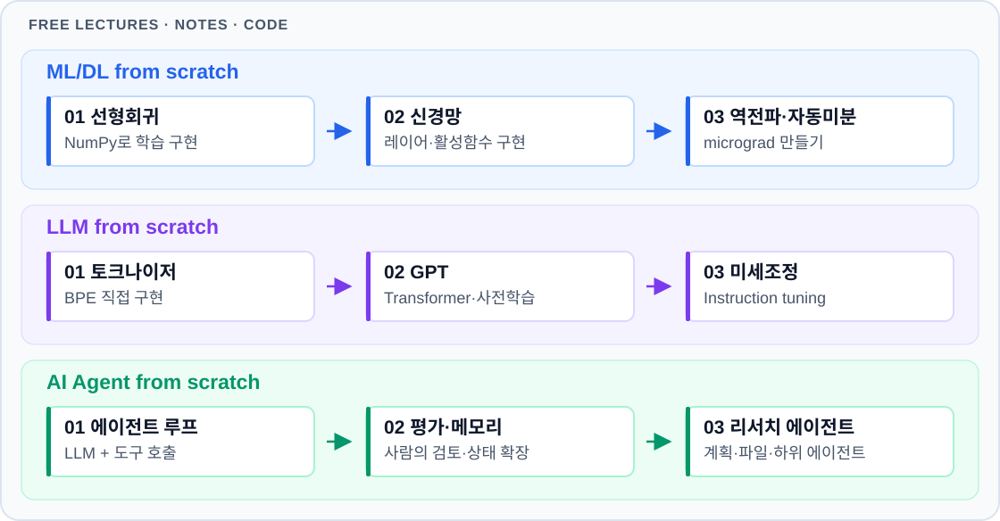

# ML / DL University Lectures

ML·DL·NLP·컴퓨터 비전·강화학습·AI 에이전트 학습 자료를 다섯 분류로 정리했습니다. **확인일: 2026-10-25**. 영상의 원 학기와 자료의 학기가 다를 수 있습니다.

Free machine learning, deep learning, LLM, and AI agent lectures, notes, and code from universities, AI companies, and creators. Includes Korean and English resources, with three from-scratch learning paths.

[강의·자료 제안 / Suggest a resource](https://github.com/teimakes/ml-dl-university/issues/new?template=lecture.yml) · [기여 안내 / Contributing](CONTRIBUTING.md)

## 시작하기 / Start here

**무료 공개 강의·노트·코드로 배웁니다.** 이 저장소는 무료 학습 자료를 모읍니다. API·GPU 사용료와 유료 인증서는 별도입니다.

아래는 이 저장소의 대학 강의에서 고른 추천 학습 순서입니다. 각 경로의 마지막 열은 직접 만들어 볼 과제입니다.

| 경로 | 대학 강의 순서 | 직접 만들어 볼 것 |
| --- | --- | --- |
| **ML/DL from scratch** | ① [서울대 ML/DL I](https://vip.snu.ac.kr/viplab/courses/mldl1_2026_1/index.html) → ② [MIT 6.S191](https://introtodeeplearning.com/) → ③ [Stanford CS231n](https://cs231n.github.io/) | NumPy로 역전파 계산 → 이미지 분류기 학습 |
| **LLM from scratch** | ① [Stanford CS224N](https://web.stanford.edu/class/cs224n/) → ② [Stanford CS336](https://cs336.stanford.edu/) → ③ [CMU 11-711](https://cmu-l3.github.io/anlp-spring2026/) | 토크나이저·Transformer 구현 → 작은 언어 모델 학습·평가 |
| **AI Agent from scratch** | ① [Stanford CS221](https://stanford-cs221.github.io/autumn2025/) → ② [CMU 11-768](https://www.cmu-agents.com/) → ③ [Stanford CS329A](https://cs329a.stanford.edu/) | 도구 호출·실행 루프 구현 → 코딩 에이전트 평가 |

공통 준비는 Python·선형대수·미분·확률입니다. LLM 경로는 신경망·PyTorch 기본기를 배운 뒤에, Agent 경로는 언어 모델의 기본 구조를 익힌 뒤에 시작하세요.

**연도 안내:** CS231n은 2026 자료·2025 공개 영상, CS224N은 2026 자료·2024 공개 영상입니다. CMU 11-768은 2026 가을 학기 진행 중이며 공개 차시가 추가됩니다. 나머지 영상·자료 링크와 학기는 아래 대학 목록에서 확인할 수 있습니다.

**자료 목록 / Browse resources**

- [한국 대학 공개강의](#한국-대학-공개강의)
- [한국 기업 공개강의](#한국-기업-공개강의)
- [해외 대학 공개강의](#해외-대학-공개강의)
- [해외 기업 공개강의](#해외-기업-공개강의)
- [유튜브 채널](#유튜브-채널)

## 한국 대학 공개강의

대학·강사·연구실 채널과 대학 강의들입니다. 채널의 개별 강의 연도와 언어는 각 영상의 안내를 확인하세요.

| 대학교/교수 | 강좌 | 채널 | 공식자료 | 주요내용 |
| --- | --- | --- | --- | --- |
| 서울대/이준석 |  | [채널](https://www.youtube.com/@LeeJoonseok) | [연구실](https://vip.snu.ac.kr/viplab) | ML·VISION |
| 서울대/이준석 | 머신러닝 및 딥러닝 1 | [재생목록](https://www.youtube.com/playlist?list=PL0E_1UqNACXCpyohL0_uMNaqr0QuXOMBi) | 2026 Spring·[강의자료](https://vip.snu.ac.kr/viplab/courses/mldl1_2026_1/index.html) | ML·DL 101 |
| 서울대/이준석 | 컴퓨터비전 | [재생목록](https://www.youtube.com/playlist?list=PL0E_1UqNACXABu9ft6PTRKaIvydxHJ9_w) | 2026 Spring·[강의자료](https://vip.snu.ac.kr/viplab/courses/mlvu_2026_1/index.html) | VISION 101 |
| 서울대/강필성 |  | [채널](https://www.youtube.com/channel/UCPq01cgCcEwhXl7BvcwIQyg) | [연구실](https://ie.snu.ac.kr/dsba_lab/) | NLP·VISON·시계열 |
| 서울대/강필성 | Text Analytics | [재생목록](https://www.youtube.com/playlist?list=PLetSlH8YjIfVzHuSXtG4jAC2zbEAErXWm) | 2021 Spring·[강의자료](https://github.com/pilsung-kang/Text-Analytics) | NLP 101 |
| 서울대/AI연구원 | AI 연구 세미나 | [채널](https://www.youtube.com/c/%EC%84%9C%EC%9A%B8%EB%8C%80%ED%95%99%EA%B5%90AI%EC%97%B0%EA%B5%AC%EC%9B%90) | [연구원](https://aiis.snu.ac.kr/) | AI 연구 세미나 |
| 고려대/김성범 |  | [채널](https://www.youtube.com/channel/UCueLU1pCvFlM8Y8sth7a6RQ/) | [연구실](https://dmqa.korea.ac.kr/) | ML·DL |
| 고려대/김성범 | 머신러닝 이론 | [재생목록](https://www.youtube.com/playlist?list=PLpIPLT0Pf7IoTxTCi2MEQ94MZnHaxrP0j) |  | ML 101 |
| 고려대/김성범 | 머신러닝 실습 | [재생목록](https://www.youtube.com/playlist?list=PLpIPLT0Pf7Io8pMhxJ6vhM1chReYa8KIn) |  | ML 실습 |
| 고려대/안준용 | LLM-Wiki  | [공개 강의자료](https://joonan30.github.io/lecture-llm-wiki/) | [GitHub](https://github.com/joonan30/lecture-llm-wiki) | AI를 활용한 논문·지식 관리, 공개 녹화 미확인 |
| KAIST/KOOC | KAIST 강의 포탈 | [홈페이지](https://online.kaist.ac.kr/kooc) | | 가입·신청 후 학습(무료) |
| KAIST/서민준 |  | [채널](https://www.youtube.com/channel/UCriDmMe_Ieb8hnox1CBiFRA) | | 
| KAIST/서민준 | AI605 — Deep Learning for NLP | [재생목록](https://www.youtube.com/playlist?list=PLN9tAT2r9TDwlfX18uHYVigflooo8DMgq) | 2022·[강의자료](https://seominjoon.github.io/kaist-ai605/) | NLP 101 |
| KOCW | 국내 대학 강의 포털 | [홈페이지](https://www.kocw.net/home/index.do) |  | 종합 강의 (무료) |

## 한국 기업 공개강의

국내 기업·재단·기관과 독립 채널의 공개 학습 자료입니다. 

| 기업·운영채널 | 공개강의 | 연도·형식 | 주요내용 |
| --- | --- | --- | --- |
| Bloom AI | [랭체인 & 랭그래프](https://www.youtube.com/playlist?list=PLs1bbgA7gF7fbga20bvT5nIRZjKxpa25n) | 유튜브 | LangChain·LangGraph 응용 강의 |
| Upstage | [Tech Talks](https://www.youtube.com/playlist?list=PLkeKJYdfv8RLyrQ5WriBcKxMwjmc0c01T) | 유튜브 | Solar·AI 관련 공개 세미나
| Upstage | [교육 허브](https://edu.upstage.ai/courses) | 튜토리얼 | Solar 활용 케이스 스터디 |
| AIFactory | [공개 라이브](https://www.youtube.com/@aifactoryspace/streams) | 유튜브 | AI 에이전트·LLM·응용 개발 관련 라이브 |

## 해외 대학 공개강의

해외 대학의 강좌와 교수 채널입니다. 오래된 강의가 있을 수 있습니다.

| 대학교/교수 | 강좌 | 채널 | 공식자료 | 주요내용 |
| --- | --- | --- | --- |--- |
| Stanford/Percy Liang | CS221 — Artificial Intelligence: Principles and Techniques| [재생목록](https://www.youtube.com/playlist?list=PLoROMvodv4rMeDqwS1yFl3j3sR_-MQNEN) | 2025 Fall·[강의자료](https://stanford-cs221.github.io/autumn2025/) |  |
| Stanford/Tengyu Ma·Chris Ré | CS229 — Machine Learning | [재생목록](https://www.youtube.com/playlist?list=PLaqpC4kq8Gpw) | 2026 Spring·[강의자료](https://cs229.stanford.edu/index.html) | 머신러닝 기초, 지도학습
| Stanford/Andrew Ng·Kian Katanforoosh | CS230 — Deep Learning | [재생목록](https://www.youtube.com/playlist?list=PLoROMvodv4rNRRGdS0rBbXOUGA0wjdh1X) | 2025 Fall·[강의자료](https://cs230.stanford.edu/) | 딥러닝 기초, 프로젝트 전략, 생성 모델, 에이전트·RAG |
| Stanford/Christopher Manning | CS224N — Natural Language Processing with Deep Learning| 2024 Spring·[재생목록](https://www.youtube.com/playlist?list=PLoROMvodv4rOaMFbaqxPDoLWjDaRAdP9D) | 2026 Winter·[강의자료](https://web.stanford.edu/class/cs224n/) | 자연어처리, 언어 모델 |
| Stanford/Fei-Fei Li·Ehsan Adeli | CS231n — Deep Learning for Computer Vision | 2025 Spring·[재생목록](https://www.youtube.com/playlist?list=PLoROMvodv4rOmsNzYBMe0gJY2XS8AQg16) | 2026 Spring·[강의자료](https://cs231n.github.io/) | 신경망, CNN, 컴퓨터 비전, 실습 |
| Stanford/Chelsea Finn | CS224R — Deep Reinforcement Learning | 2025 Spring·[재생목록](https://www.youtube.com/playlist?list=PLoROMvodv4rPwxE0ONYRa_itZFdaKCylL) | 2026 Spring·[강의자료](https://cs224r.stanford.edu/) | 모방학습, 딥 강화학습, 로보틱스·언어 모델 응용 |
| Stanford/Percy Liang·Tatsunori Hashimoto | CS336 — Language Modeling from Scratch | [재생목록](https://www.youtube.com/playlist?list=PLoROMvodv4rMqXOcazWaTUHhq-yembLCV) | 2026 Spring·[강의자료](https://cs336.stanford.edu/) | 토크나이저, Transformer 구현, GPU 최적화, 데이터, 평가, 후학습 |
| Stanford/Afshine Amidi·Shervine Amidi | CME295 — Transformers and Large Language Models | 2026 Fall·[재생목록](https://www.youtube.com/playlist?list=PLakGfbKCei80), 2025 Fall·[재생목록](https://www.youtube.com/playlist?list=PLoROMvodv4rOCXd21gf0CF4xr35yINeOy) | 2026 Fall·[강의자료](https://cme295.stanford.edu/syllabus/) | Transformer, LLM 학습, RLHF·DPO |
| Stanford/Afshine Amidi·Shervine Amidi | CME296 — Diffusion & Large Vision Models | 2026 Spring·[재생목록](https://www.youtube.com/playlist?list=PLoROMvodv4rNdy8rt2rZ4T2xM0OjADnfu) | 2026 Spring·[강의자료](https://cme296.stanford.edu/) | diffusion·score matching·flow matching·대규모 비전 모델 |
| Stanford/Aakanksha Chowdhery·Azalia Mirhoseini | CS329A — Self-Improving AI Agents| [재생목록](https://www.youtube.com/playlist?list=PLangBM27OtEA) | [강의자료](https://cs329a.stanford.edu/) | 추론 시 연산 확장, 검증기, 도구·코드 피드백, 계획, 에이전트 평가 |
| MIT/Alexander Amini | MIT6.S191 — Introduction to Deep Learning | 2026·[재생목록](https://www.youtube.com/playlist?list=PLtBw6njQRU-rwp5__7C0oIVt26ZgjG9NI) | 2026·[강의자료](https://introtodeeplearning.com/) | 딥러닝 입문, 생성 모델, LLM, 강화학습 |
| MIT/Paul Liang | MAS.S60 — How to AI (Almost) Anything / Paul Liang | 2025 Spring·[재생목록](https://www.youtube.com/playlist?list=PLc0Yh0D0XR4Z3wityRaEuu4rfzTHRIIAO) | [강의자료](https://mit-mi.github.io/how2ai-course/spring2025/) | 멀티모달 정렬·융합, 기반 모델, 인간-AI 상호작용 |
| CMU/Sean Welleck | CMU CS 11-711 — Advanced NLP | 2026 Spring·[재생목록](https://www.youtube.com/playlist?list=PLqC25OT8ZpD15emhQhNjRLym77-sp2kAx) | 2026 Spring·[강의자료](https://cmu-l3.github.io/anlp-spring2026/) | LLM의 모델링·학습·추론, 평가, 강화학습·에이전트 |
| CMU/Graham Neubig |  | [채널](https://www.youtube.com/user/neubig) | [연구실](https://www.phontron.com/neulab) | NLP |
| CMU/Graham Neubig | CMU 11-768 — AI Agents | 2026 Fall·[재생목록](https://www.youtube.com/playlist?list=PLSN0qpDfUvTM) | [강의자료](https://www.cmu-agents.com/) | AI Agent |
| CMU/Graham Neubig | CMU 11-664/763 — Inference Algorithms for Language Modeling | 2025 Fall·[재생목록](https://www.youtube.com/playlist?list=PL8PYTP1V4I8DY15Ob83nmwBAVyNtUQadX) | [강의자료](https://www.phontron.com/class/lminference-fall2025/) | LLM Inference |
| NYU/Alfredo Canziani | NYU-DLFL25U — Introduction to Deep Learning Research | [재생목록](https://www.youtube.com/playlist?list=PLLHTzKZzVU9cKSM86olUgLhpLKs_-N2K4) | [강의자료](https://atcold.github.io/NYU-DLFL25U/) | 신경망의 수학적 이해와 구현 |
| UMD/Mohit Iyyer | CMSC723 — Natural Language Processing | 2026 Fall·[재생목록](https://www.youtube.com/playlist?list=PLFq3c7ZsRdno) | [강의자료](https://www.cs.umd.edu/~miyyer/cmsc723/) | NLP·LLM |

## 해외 기업 공개강의

제작사·개발사의 공식 학습 자료입니다. 자료 열람과 API 실습·수강·인증서의 이용 조건은 다를 수 있습니다.

| 기업·운영채널 | 공개강의 | 연도·형식 | 주요내용 |
| --- | --- | --- | --- |
| OpenAI | [Developer Learn](https://developers.openai.com/learn) · [Cookbook](https://developers.openai.com/cookbook) | 학습 경로·영상·코드 예제 | 에이전트 구축, AI 앱 개발, 모델 최적화. 개별 예제의 SDK·API 버전 확인 |
| Anthropic | [Claude Academy](https://academy.claude.com/) | 무료 강좌·튜토리얼 | Claude 활용 프롬프팅, 도구 사용, RAG, 에이전트, MCP와 운영 패턴을 다룸 |
| Gemini | [공식 Cookbook](https://github.com/google-gemini/cookbook) | 실습·노트북 | 멀티모달 입력·도구 호출 등 API 노트북·예제 등 |
| Mistral AI | [Learn with Mistral](https://learn.mistral.ai/) · [Cookbooks](https://docs.mistral.ai/resources/cookbooks) · [공식 Quickstarts](https://docs.mistral.ai/) | 웨비나·영상·코드 예제 | API 입문, OCR·문서 처리, RAG, 에이전트·워크플로. Cookbook에는 커뮤니티 작성 예제도 포함 |
| Grok | [Quickstart](https://docs.x.ai/developers/quickstart) | 문서·코드 | API 호출, 추론, 구조화 출력, 도구 호출·검색. 공개 정규 강의 재생목록으로 분류하지 않음 |
| LangChain | [LangChain Academy](https://academy.langchain.com/) | 공식 강좌 | LangChain·LangGraph 입문, Deep Agents, LangSmith 평가·배포·관측. 강좌 콘텐츠 무료, 인증 시험은 별도 |
| Hugging Face | [전체 Learn](https://huggingface.co/learn) | 텍스트·영상·노트북 | Transformers, 데이터·토크나이저, 미세조정, 추론 모델, 에이전트 구현 |
| Microsoft | [Generative AI for Beginners](https://github.com/microsoft/generative-ai-for-beginners) | Version 3 · 21레슨 | 개념 설명·짧은 영상·Python/TypeScript 예제. 저장소에 한국어 번역 링크 제공 |

## 유튜브 채널

유튜버·독립 연구자·교육 채널의 공개 강의와 학습 자료입니다.

| 채널 | 공개강의 | 공개자료 | 주요내용 |
| --- | --- | --- | --- |
| [Andrej Karpathy](https://www.youtube.com/@AndrejKarpathy) | [Neural Networks: Zero to Hero](https://www.youtube.com/playlist?list=PLAqhIrjkxbuWI23v9cThsA9GvCAUhRvKZ) | [강의 노트·코드](https://github.com/karpathy/nn-zero-to-hero) | micrograd·makemore·GPT·BPE 토크나이저를 직접 구현하는 보충 강의 |
| [Umar Jamil](https://www.youtube.com/@umarjamilai/videos) | [Building a distributed training framework from first principles](https://www.youtube.com/watch?v=XoGvCBRnwLs) | [TorchFeather 코드](https://github.com/hkproj/torchfeather) | **2026-08-18** · PyTorch 분산 학습, DDP·FSDP·파이프라인·텐서·전문가 병렬화. Transformer 구현 이후의 심화 자료 |
| [Umar Jamil](https://www.youtube.com/@umarjamilai/videos) | [Coding a Transformer from scratch](https://www.youtube.com/watch?v=ISNdQcPhsts) | [구현 코드](https://github.com/hkproj/pytorch-transformer) | 2023 공개 영상 · Attention·Transformer·학습·추론을 따라 구현하는 보충 강의 |
| [Vizuara](https://www.youtube.com/@vizuara) | [신경망 직접 구현](https://www.youtube.com/playlist?list=PLPTV0NXA_ZSj6tNyn_UadmUeU3Q3oR-hu) | 강의 별 description에 학습 자료 링크 제공 | 뉴런·레이어·활성함수를 코드로 구현하며 신경망 기초 학습 |
| [Vizuara](https://www.youtube.com/@vizuara) | [SLM 직접 만들기](https://www.youtube.com/watch?v=pOFcwcwtv3k) | [Colab 노트북](https://colab.research.google.com/drive/1k4G3G5MxYLxawmPfAknUN7dbbmyqldQv?usp=sharing)  | 소형 언어 모델 직접 구현 워크숍 |
| [Sebastian Raschka](https://www.youtube.com/@SebastianRaschka) | [LLM 영상 목록](https://www.youtube.com/playlist?list=PLTKMiZHVd_2Licpov-ZK24j6oUnbhiPkm) |  | LLM·추론 모델의 원리와 구현 해설 |
| [Sebastian Raschka](https://www.youtube.com/@SebastianRaschka) |  | [LLMs from Scratch 코드](https://github.com/rasbt/LLMs-from-scratch) | PyTorch로 토크나이저·Attention·LLM 구현, 사전학습·미세조정 |
| [Sebastian Raschka](https://www.youtube.com/@SebastianRaschka) |  | [Reasoning from Scratch 코드](https://github.com/rasbt/reasoning-from-scratch) | 추론 모델 구현, 평가·추론 시 연산 확장·강화학습·증류 |
| [Lera Andronova](https://www.youtube.com/@lerabyte) | [LLM 직접 구현 입문](https://www.youtube.com/watch?v=u1_qczBrhow) | [예제 코드](https://github.com/lerabyte/llm-build) | 언어 모델의 작동 원리와 구현 입문 |
| [Justin Angel](https://www.youtube.com/@JustinAngelAI) | [Build Your Own LLM Workshop](https://www.youtube.com/playlist?list=PLweJS2YZCfkeXXdfCKGaxAhm2w8p0u1z6) | 강의 별 description에 학습 자료 링크 제공 | PyTorch·토크나이저·Attention·사전학습·평가·instruction tuning·강화학습 |
| [Syntax](https://www.youtube.com/@syntaxfm) | [LLMs Explained](https://www.youtube.com/watch?v=YmLp8qe87A0) | [예제 코드](https://github.com/w3cj/how-llms-work) | 토큰·임베딩·Transformer의 원리와 코드 실습 |
| [AI Engineer](https://www.youtube.com/@aiDotEngineer) | [Training an LLM from Scratch, Locally](https://www.youtube.com/watch?v=UsB70Tf5zcE) |  | 로컬 환경에서 LLM 학습. ElevenLabs의 Angelos Perivolaropoulos 발표 |

확인 기록·기여 방법

강좌 소개와 공개 목록을 확인한 범위이며, 전체 영상 시청·모든 차시 재생·과제 실행·코드 호환성을 검수한 것은 아닙니다. 자세한 출처와 미확인 사항은 아래 기록에 있습니다.

- [From scratch 구성·공식 출처·참고 저장소](docs/from-scratch-roadmap-2026-10-25.md)
- [기존 강의 확인 기록](docs/verification-2026-10-25.md)
- [KOCW·KOOC·이준석·말러랩 확인 기록](docs/additional-sources-2026-10-25.md)
- [대학·기업 확장 목록 확인 기록](docs/global-resources-2026-10-25.md)
- [브라우저 채널·기업 교육 페이지 확인 기록](docs/browser-sources-2026-10-25.md)
- [강의·자료 제안하기](https://github.com/teimakes/ml-dl-university/issues/new?template=lecture.yml) · [기여 안내](CONTRIBUTING.md)

