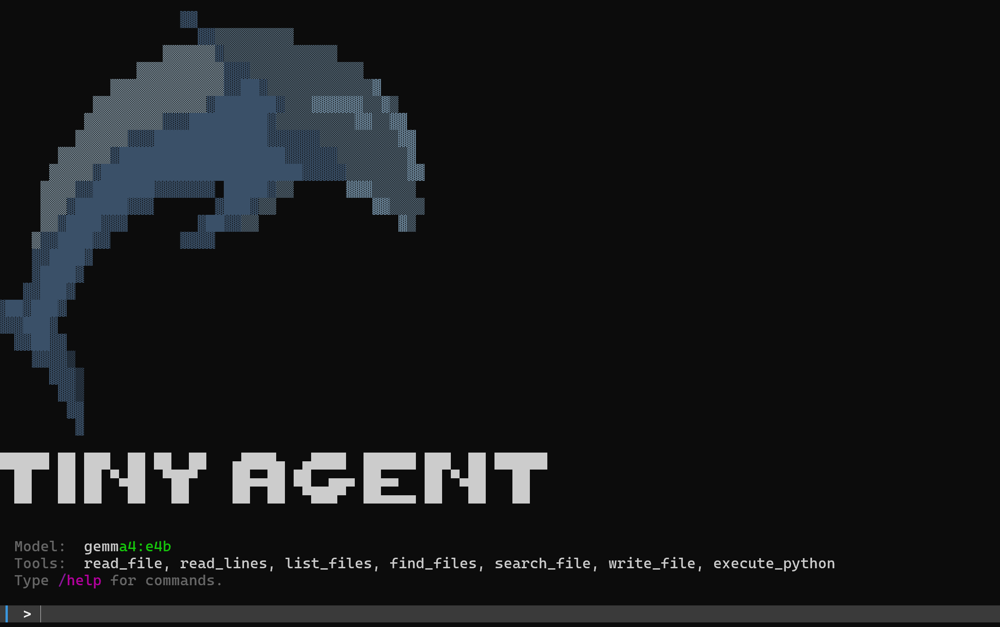

# 실습 환경 설정

이 저장소는 Python 3.12 이상을 사용합니다. 1장은 에이전트의 기본 구조를 정의합니다. 모델을 호출하는 예제는 OpenAI 호환 API에 연결합니다. 로컬 서버와 클라우드 모델의 연결 설정은 [2장](../chapter02/chapter02.ipynb)에 있습니다. MCP 등의 보충 실습에는 추가 패키지가 사용됩니다.

## JupyterLab에서 한국어 노트북 실행

`free-ai-campus` 폴더에서 다음 명령으로 실습 폴더에 들어갑니다.

```sh
cd docs/ko/illustrated-ai-agents
```

이 폴더에 `pyproject.toml`이 있습니다. 아래 두 가지 설치 방법 중 하나를 선택합니다. 이 폴더의 패키지를 설치하면 노트북에서 가져오는 장별 코드 해설도 한국어로 표시됩니다.

### pip 사용

선택한 Python 환경에 실습 패키지와 JupyterLab을 설치한 뒤 실행합니다.

```sh
python -m pip install -e ".[jupyter]"
python -m jupyter lab
```

### uv 사용

[uv 설치 안내](https://docs.astral.sh/uv/getting-started/installation/)에 따라 uv를 준비하고 아래 명령을 실행합니다.

```sh
uv sync --extra jupyter
uv run jupyter lab
```

JupyterLab의 파일 목록에서 `chapter01/chapter01.ipynb`를 엽니다. 각 셀은 **Shift+Enter**로 실행합니다. 실행이 끝나면 다음 셀로 이동합니다.

PyPI에 공개된 영어 패키지만 설치할 때는 `python -m pip install "illustrated-agents[jupyter]"` 또는 `uv add illustrated-agents --extra jupyter`를 사용합니다. GitHub의 영어 소스는 `python -m pip install git+https://github.com/HandsOnLLM/An-Illustrated-Guide-To-AI-Agents.git`으로 설치할 수 있습니다.

## 터미널에서 TinyAgent 실행

명령줄 인터페이스만 사용할 때는 `terminal` 선택 의존성을 설치합니다. 로컬 모델을 사용할 경우 2장의 안내에 따라 모델 서버를 먼저 실행합니다.

```sh
python -m pip install -e ".[terminal]"
tinyagent
```

uv의 별도 도구 환경에 설치할 때는 같은 폴더에서 다음과 같이 실행합니다.

```sh
uv tool install ".[terminal]"
tinyagent
```



## Google Colab 사용

[Colab](https://colab.research.google.com/)의 **파일 → 노트북 업로드**에서 한국어 `.ipynb`를 선택합니다. 노트북 상단의 설치 셀에서 필요한 명령의 주석을 해제하고 실행합니다. Colab 안에서 Ollama 모델을 구동할 때에는 T4 GPU 런타임을 선택합니다. 원격 API를 사용한다면 해당 서비스의 모델 이름, 주소와 API 키를 지정합니다.

업로드한 노트북에서 PyPI의 `illustrated-agents`를 설치하면 패키지가 생성하는 코드 해설은 영어입니다. 한국어 해설을 사용하려면 Colab에서 이 저장소의 `src`와 `pyproject.toml`이 있는 폴더에 접근할 수 있도록 준비한 후 그 폴더의 패키지를 설치합니다.
