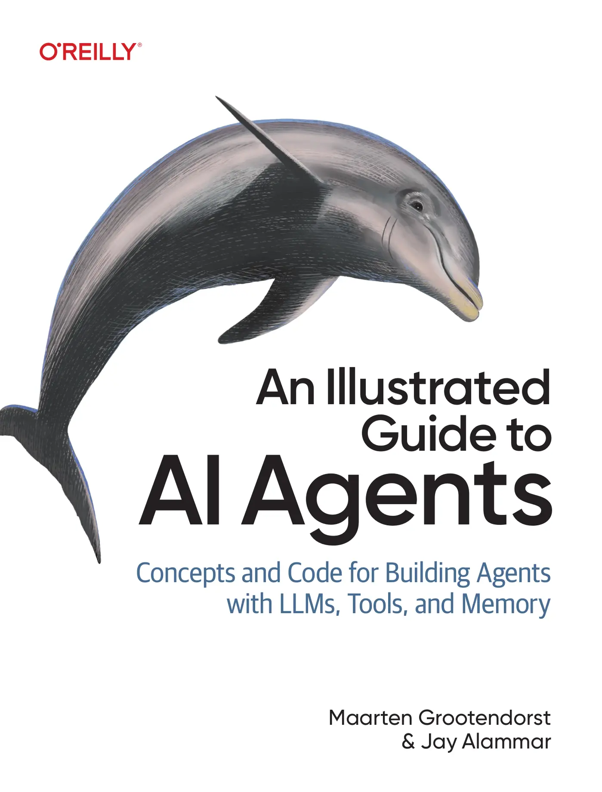
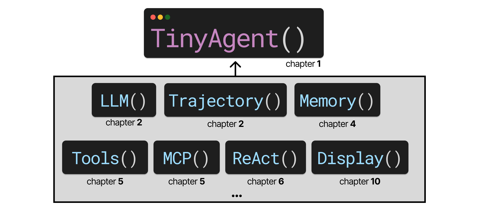
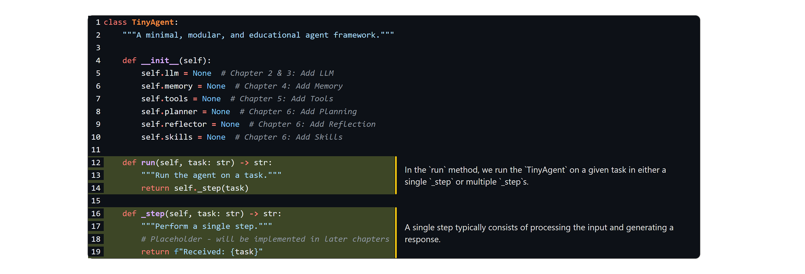
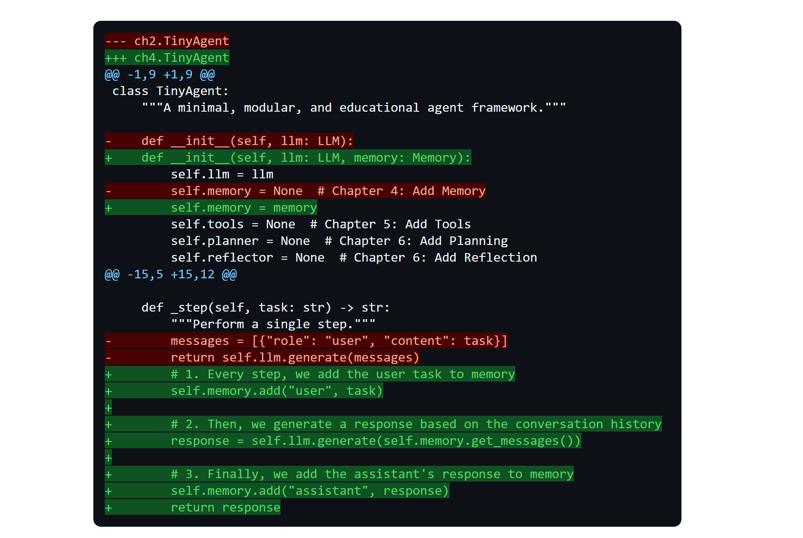

# 그림으로 배우는 AI 에이전트

Maarten Grootendorst와 Jay Alammar가 쓴 *An Illustrated Guide to AI Agents*의 장별 실습을 한국어로 옮긴 비공식 학습 자료입니다. 언어 모델을 한 번 호출하는 파이썬 클래스부터 시작해 대화 기록, 도구 호출, 여러 단계의 실행을 지원하는 `TinyAgent`를 구현합니다. 책에는 300개가 넘는 그림이 수록되어 있으며 아래 노트북은 장별 코드 실습에 해당합니다. [도서 정보](https://www.oreilly.com/library/view/an-illustrated-guide/9798341662681/) · [영어 원본 저장소](https://github.com/HandsOnLLM/An-Illustrated-Guide-To-AI-Agents)



## 실습 시작

처음에는 [환경 설정 안내](.setup/README.md)에 따라 Python 3.12 이상에서 이 폴더의 패키지를 설치합니다. JupyterLab에서 [1장 노트북](chapter01/chapter01.ipynb)을 열고 위에서부터 셀을 실행합니다. 1장은 모델 연결 없이 진행할 수 있고, 2장부터는 로컬 모델 서버 또는 호환 API를 사용합니다.

Colab에서는 **파일 → 노트북 업로드**에서 아래의 한국어 `.ipynb`를 선택합니다. 노트북이 참조하는 로컬 그림과 한국어 코드 해설까지 함께 보려면 저장소 폴더 구조를 유지해 JupyterLab에서 실행합니다.

## 장별 실습

| 장 | 한국어 기본 노트북 | 한국어 보충 노트북 | 영어 원본 |
|---|---|---|---|
| 1 | [AI 에이전트 소개](chapter01/chapter01.ipynb) | — | [Colab](https://colab.research.google.com/github/HandsOnLLM/An-Illustrated-Guide-To-AI-Agents/blob/main/chapter01/chapter01.ipynb) |
| 2 | [대규모 언어 모델](chapter02/chapter02.ipynb) | — | [Colab](https://colab.research.google.com/github/HandsOnLLM/An-Illustrated-Guide-To-AI-Agents/blob/main/chapter02/chapter02.ipynb) |
| 3 | [언어 모델의 추론](chapter03/chapter03.ipynb) | — | [Colab](https://colab.research.google.com/github/HandsOnLLM/An-Illustrated-Guide-To-AI-Agents/blob/main/chapter03/chapter03.ipynb) |
| 4 | [메모리와 검색](chapter04/chapter04.ipynb) | [단기 메모리](chapter04/chapter04_short_term_memory.ipynb) · [장기 메모리와 RAG](chapter04/chapter04_long_term_memory.ipynb) | [Colab](https://colab.research.google.com/github/HandsOnLLM/An-Illustrated-Guide-To-AI-Agents/blob/main/chapter04/chapter04.ipynb) |
| 5 | [도구와 MCP](chapter05/chapter05.ipynb) | [MCP 서버와 클라이언트](chapter05/chapter05_mcp.ipynb) · [모델 자체의 도구 호출](chapter05/chapter05_native_tool_calling.ipynb) · [스킬](chapter05/chapter05_skills.ipynb) | [Colab](https://colab.research.google.com/github/HandsOnLLM/An-Illustrated-Guide-To-AI-Agents/blob/main/chapter05/chapter05.ipynb) |
| 6 | [계획 수립과 ReAct](chapter06/chapter06.ipynb) | [모델 자체의 추론과 도구 호출을 이용한 ReAct](chapter06/chapter06_native_react.ipynb) | [Colab](https://colab.research.google.com/github/HandsOnLLM/An-Illustrated-Guide-To-AI-Agents/blob/main/chapter06/chapter06.ipynb) |
| 7 | [에이전트 평가](chapter07/chapter07.ipynb) | — | [Colab](https://colab.research.google.com/github/HandsOnLLM/An-Illustrated-Guide-To-AI-Agents/blob/main/chapter07/chapter07.ipynb) |
| 8 | [다중 에이전트 협업](chapter08/chapter08.ipynb) | — | [Colab](https://colab.research.google.com/github/HandsOnLLM/An-Illustrated-Guide-To-AI-Agents/blob/main/chapter08/chapter08.ipynb) |
| 9 | [멀티모달 이해](chapter09/chapter09.ipynb) | — | [Colab](https://colab.research.google.com/github/HandsOnLLM/An-Illustrated-Guide-To-AI-Agents/blob/main/chapter09/chapter09.ipynb) |
| 10 | [코딩 에이전트](chapter10/chapter10.ipynb) | — | [Colab](https://colab.research.google.com/github/HandsOnLLM/An-Illustrated-Guide-To-AI-Agents/blob/main/chapter10/chapter10.ipynb) |

[약어 풀이](appendix/glossary.md) · [장별 참고문헌](appendix/bibliography.md) · [TinyAgent 소스 안내](src/illustrated_agents/README.md)

## 코드와 그림 읽기

각 장은 이전 장의 코드를 이어서 수정합니다. 아래 그림은 `TinyAgent`에 언어 모델, 메모리, 도구, 계획 기능이 어느 순서로 추가되는지 보여 줍니다.



노트북의 코드 해설에서는 특정 줄 옆에 설명을 붙입니다. 아래 예시처럼 메서드의 어느 부분이 현재 단계의 동작을 담당하는지 확인할 수 있습니다.



코드를 비교하는 화면에서 빨간 줄은 이전 장에서 삭제한 부분이고 초록 줄은 새로 추가한 부분입니다.



## 보충 읽을거리

[보충 자료 목록](bonus/README.md)에는 Gemma 4의 구조와 멀티모달 생성에 대한 한국어 소개, 원문 링크가 있습니다.

## 원서 서평

- Chip Huyen은 그림과 `TinyAgent` 실습을 통해 개념을 이해할 수 있다고 평했습니다. 저서로 *AI Engineering*과 *Designing Machine Learning Systems*가 있습니다.
- MIT EECS의 Omar Khattab은 그림으로 에이전트의 동작과 구현에 사용되는 개념을 설명하는 방식을 언급했습니다.
- Meta FAIR 연구자이자 SWE-bench와 SWE-agent의 공동 저자인 Ofir Press는 토큰화부터 다중 에이전트까지 다룬 범위에 주목했습니다.

## 도서 인용

```bibtex
@book{illustrated-agents-book,
  author       = {Maarten Grootendorst and Jay Alammar},
  title        = {An Illustrated Guide to AI Agents},
  publisher    = {O'Reilly},
  year         = {2026},
  isbn         = {979-8341662698},
  url          = {https://www.oreilly.com/library/view/an-illustrated-guide/9798341662681/},
  github       = {https://github.com/HandsOnLLM/An-Illustrated-Guide-To-AI-Agents}
}
```
