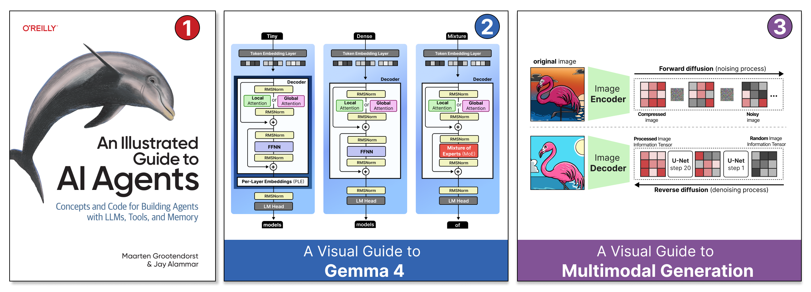

# 보충 자료

책에서는 언어 모델, 추론, 메모리, 도구와 계획 수립을 다룹니다. 아래 자료는 책에 모두 담지 못한 주제를 그림으로 더 자세히 설명합니다. 한국어 소개에서 내용을 확인한 뒤 저자들의 원문을 읽을 수 있습니다.

| 자료 | 다루는 내용 | 관련 실습 |
|---|---|---|
| [Gemma 4 소개](gemma-4.md) · [전체 글(영어)](https://newsletter.maartengrootendorst.com/p/a-visual-guide-to-gemma-4) | 모델별 구조, 연산량을 줄이는 방법, 이미지와 오디오 인식 | [2장 언어 모델](../chapter02/chapter02.ipynb), [9장 멀티모달 이해](../chapter09/chapter09.ipynb) |
| [멀티모달 생성 소개](multimodal-generation.md) · [전체 글(영어)](https://newsletter.maartengrootendorst.com/p/a-visual-guide-to-multimodal-generation) | 이미지·오디오·비디오 생성과 언어 모델에 생성 기능을 결합하는 방법 | [9장 멀티모달 이해](../chapter09/chapter09.ipynb) |
