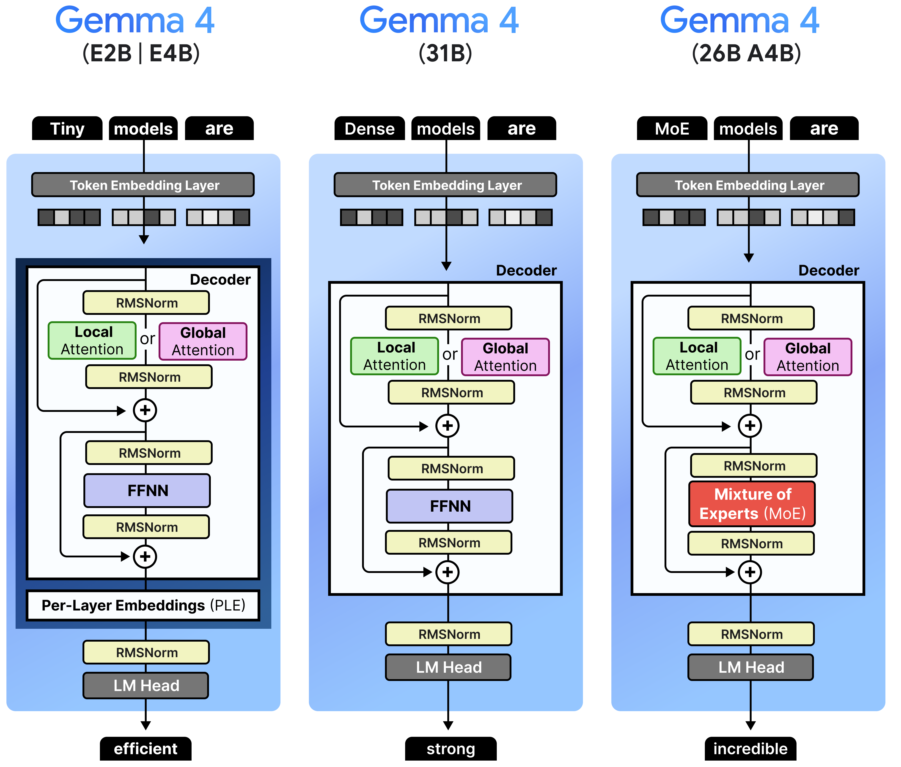
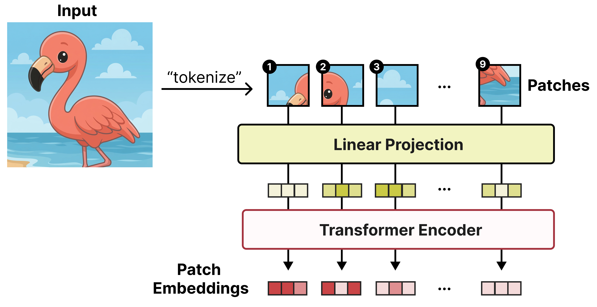

# Gemma 4의 구조

[2장](../chapter02/chapter02.ipynb)에서는 언어 모델의 동작 원리를 살펴보고 Gemma 4를 `TinyAgent`에 연결합니다. [9장](../chapter09/chapter09.ipynb)에서는 이미지와 텍스트를 함께 처리하도록 에이전트를 확장합니다.

저자들의 보충 글은 소형 Gemma 4가 연산량을 줄이는 방법과 대형 모델과의 구조 차이를 설명합니다. 지역 어텐션과 전역 어텐션, 전문가 혼합(MoE), 소형 모델의 층별 임베딩을 다룹니다. [전체 글(영어)](https://newsletter.maartengrootendorst.com/p/a-visual-guide-to-gemma-4)

이미지와 오디오는 각각의 인코더를 거쳐 언어 모델이 처리할 수 있는 임베딩이 됩니다. 그림은 비전 인코더가 이미지를 패치로 나누고 임베딩으로 바꾸는 과정입니다.

글 후반부에서는 여러 토큰을 함께 예측하는 MTP(Multi-Token Prediction)가 생성 속도를 높이는 방법도 살펴봅니다.
