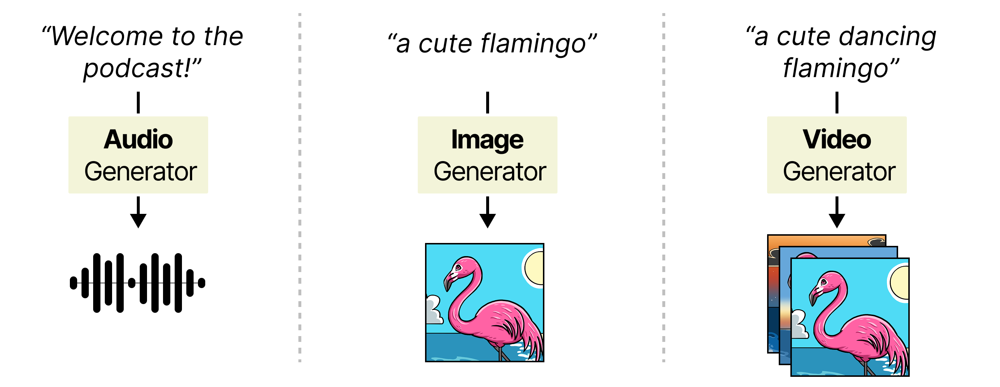
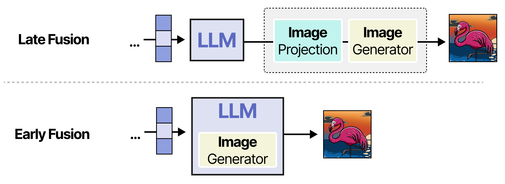

# 멀티모달 생성

[9장](../chapter09/chapter09.ipynb)은 이미지·오디오·비디오를 모델이 이해하는 방법을 소개하고 텍스트와 이미지를 함께 입력하는 예제를 다룹니다. 이 보충 글에서는 모델이 직접 이미지와 소리, 동영상을 생성하는 과정을 살펴봅니다.

저자들은 50개가 넘는 그림을 사용해 이미지 생성에 쓰이는 Stable Diffusion과 확산 트랜스포머, 오디오 생성용 AudioLM, 확산 모델을 비디오 생성에 적용하는 방법을 설명합니다. [전체 글(영어)](https://newsletter.maartengrootendorst.com/p/a-visual-guide-to-multimodal-generation)

언어 모델에 별도 생성기를 연결하는 후기 융합(late fusion)과 모델 구조 안에 여러 형식의 생성 기능을 결합하는 초기 융합(early fusion)을 비교합니다. NExT-GPT와 Janus가 예시입니다.

이 글은 책의 한 장으로 준비했다가 별도의 무료 자료로 공개한 내용입니다.
