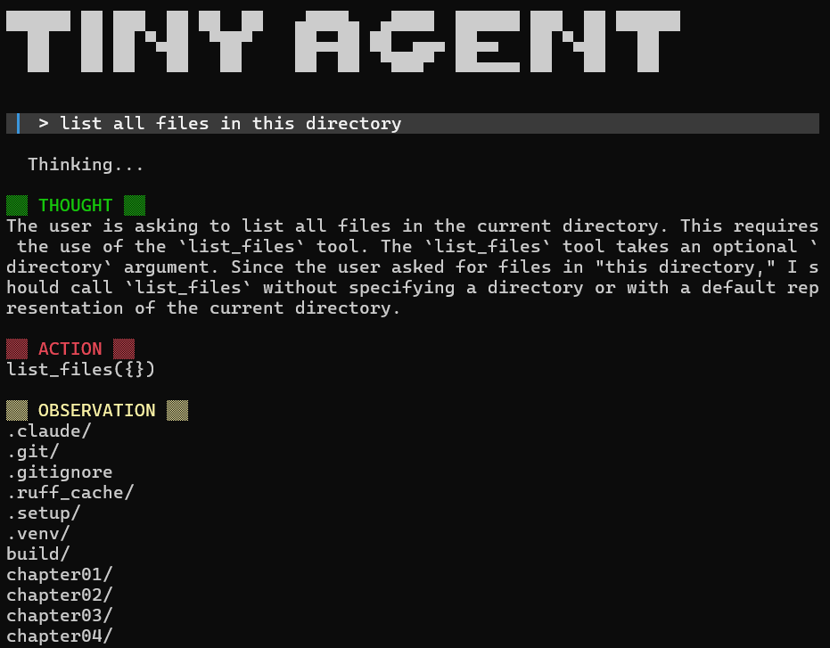

# 10장 코딩 에이전트

[코딩 에이전트](chapter10.ipynb)

노트북에서 파일 작업과 파이썬 실행을 지원하는 명령줄 인터페이스를 구현합니다. 설치 후 `docs/ko/illustrated-ai-agents` 폴더에서 다음 명령으로 해당 장의 예제를 실행할 수도 있습니다.

```sh
python -m illustrated_agents.chapters.ch10
```


