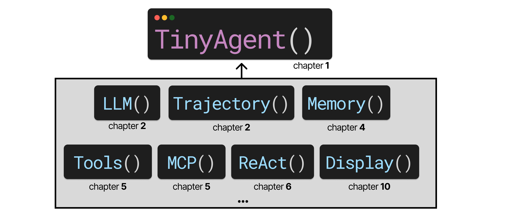

# TinyAgent 소스 코드

각 장은 `TinyAgent`에 모듈을 하나씩 연결합니다. 언어 모델 호출은 `llm.py`, 대화 기록은 `memory.py`, 도구 등록과 호출은 `tools.py`, 추론과 행동의 반복은 `planning.py`에서 다룹니다. [장별 실습 목차](../../README.md)



다음 예제는 `docs/ko/illustrated-ai-agents` 폴더에서 실행합니다. Ollama가 `gemma4:e4b`를 제공하면 에이전트가 `multiply`를 호출할 수 있습니다. `Skills`에는 일반 도구와 마크다운으로 작성한 작업 절차를 함께 등록할 수 있습니다.

```python
from illustrated_agents import Display, LLM, Memory, NativeReAct, Skills, TinyAgent
from illustrated_agents.toolbox import multiply

llm = LLM(model="gemma4:e4b", think=True)
tools = Skills()
tools.add_tool("multiply", multiply, "두 수를 곱합니다.")

agent = TinyAgent(
    llm=llm,
    memory=Memory(),
    tools=tools,
    planner=NativeReAct(max_steps=10),
    display=Display(),
)
print(agent.run("multiply 도구로 12와 8을 곱해 줘."))
```

[장별 구현](chapters/)에서 각 단계의 코드를 비교하고, [스킬 실습](../../chapter05/chapter05_skills.ipynb)에서 `add_skill`로 작업 지침을 등록하는 방법을 확인할 수 있습니다.
